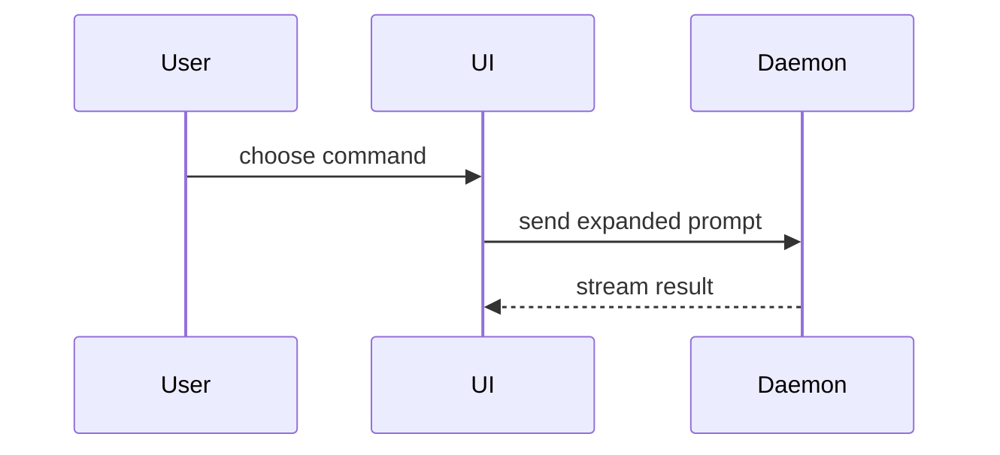

Use this template for writing the PR body:

```markdown
## Summary

<diagram, diff-sketch, or tree>

## Evidence

- **Before:** <screenshot/output/failing test run>
  **After:** <screenshot/output/passing test run>

## Merge Danger

**Door:** <one-way or two-way>

<optional: description>

**Blast Radius:** <one-word description>

<optional: potential ramifications of merge>
```

## Sections

Skip all preambles and keep prose brief. Use the user's domain language from `GLOSSARY.md`.

### Summary

Pick the smallest view that makes the key point clear.

- Show logic or an algorithm as pseudocode:

```text
on(save)
  if content is unchanged
    return cached result
  write new content
  return fresh result
```

- Show runtime control flow as a call tree:

```text
submitForm
  createSession
    persistPrompt
    launchAgent
  navigateToSession
```

- Show UI structure as a component tree, including state and module boundaries that matter:

```text
<SessionPage> (apps/example/src/routes/session.tsx)
  useSessionEvents()
  <SessionToolbar>
    <RunSkillButton> (packages/ui)
```

- Show file responsibility or a broad refactor as a shallow file tree:

```text
src/
├── commands/       # parses user actions
├── sessions/       # owns session state
└── transport/      # sends API requests
```

- Show component interaction, control flow, or data flow with Mermaid:



- Use `diff` when the point is what changes and the surrounding shape already exists. Match the diff shape to the topic.

For a component change:

```diff
 <SessionPage>
   useSessionEvents()
   <SessionToolbar>
+    <RunSkillButton />
   <SessionTimeline>
+    <SkillResultCard />
```

For a file-layout change:

```diff
 src/
 ├── commands/
+│   └── show-me.ts       # expands the slash command
 ├── sessions/
-└── transport.ts
+└── transport/
+    ├── client.ts
+    └── stream.ts
```

For a call-tree or call-stack change:

```diff
 submitForm
   createSession
     persistPrompt
+    expandSkillMention
     launchAgent
-  navigateToSession
+  navigateToSession
+    subscribeToEvents
```

For a state or control-flow change:

```diff
 on(save)
-  write content
+  if content is unchanged
+    return cached result
+  write new content
+  invalidate cache
```

- Show the whole block when most of it is new, when omitted context would hide ownership or order, or when the user needs a copyable target shape:

```ts
function expandSkill(command: string): string {
  const skillName = command.slice(1);
  return `use the ${skillName} skill`;
}
```

#### Guidance

Place each visual next to the short text it supports. Keep only the calls, files, props, states, and boundaries needed to answer the user's current question or the options to resolve the current discussion point.

You may use one of these, you may use several, it is unlikely you will use all of them. Use your judgement and don't overwhelm the user.

### Evidence

Concrete evidence that the change works. Show a before and after.

Screenshots are S-tier - when the environment is set up for it and the change is visual.

Execution-based evidence is A-tier. Test results, console output. Show the exact test that now fails and passes, using pseudocode.

### Merge Danger

Describe whether it's a one-way or two-way door. You can walk back through two-way doors, but not one-way doors. A PR that is cheap to roll back is lower risk. Changes that involve destructive actions or hard-to-reverse decisions are one-way doors.

The blast radius is the potential impact or scope of the changes introduced by this PR. Consider all possibilities. Examples are layout shift, breakages for consumers, mobile responsiveness, etc.

## Adaptations for TaskFlow

These rules extend the upstream skill for this repository. Where they differ, they win.

### Who opens the PR

The agent never pushes and never opens the PR (there is no `gh` here). At the end of a branch, give the developer a **ready-to-paste title and body** in the conversation; the developer pushes and opens the PR.

- **Title:** the commit convention of RULE.md §8, e.g. `feat(workspace): add member invitation flow`.
- **Body:** the template above, in English (like the rest of the repository).
- **No AI attribution:** no "Generated with …" line and no `Co-Authored-By` trailer.

### Extra section: Decisions

After **Merge Danger**, add:

```markdown
## Decisions

- ADRs added or changed: <ADR-NNNN title, or "none">
- Spec / plan / tasks: <paths under docs/>
```

### Evidence in this project

- Code: the result of `pnpm lint && pnpm typecheck && pnpm test && pnpm test:e2e` (counts of passed tests), plus the red → green test of the main behaviour, as pseudocode (ADR-0039).
- Frontend (from M2): screenshots, which the developer attaches.
- Docs-only PRs: say "Docs only, no code changes" and show what was checked (links, stale references).

### Doors in this project

One-way doors here:
- a migration that drops, renames or rewrites data (it must follow expand → migrate → contract, ADR-0036);
- changing a **merged** ADR's decision without a superseding ADR;
- anything touching production secrets, cookie settings or tenant isolation (ADR-0020, ADR-0021).

Most other changes are two-way doors.

### Stacked branches

If the branch was created from another unmerged branch, say so in the first line of the body and give the merge order.
